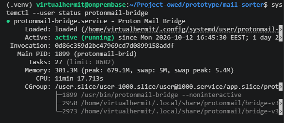
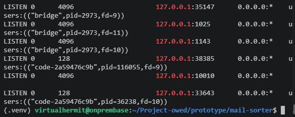
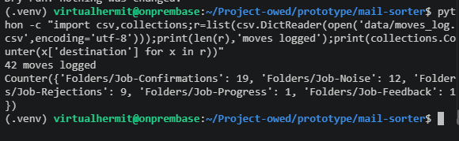
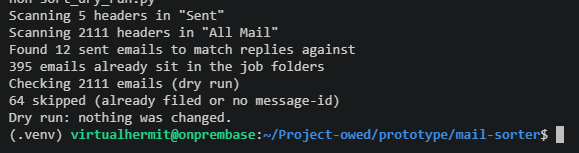
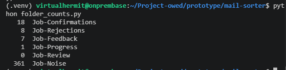

# Project-owed (Application tracker)

A self hosted tool that sorts my job application mail into folders through Proton Mail Bridge, building toward a simple job tracker.

## Contents

- [Idea in short](#idea-in-short)
- [How it started](#how-it-started)
- [Building the idea itself](#building-the-idea-itself)
- [Proton mail bridge on the server](#proton-mail-bridge-on-the-server)
- [Mail sorter](#mail-sorter)
- [Dry run tests](#dry-run-tests)
- [Running the sorter](#running-the-sorter)
- [Splitting the rules from the mailbox code](#splitting-the-rules-from-the-mailbox-code)

## Idea in short

**Problem:** my job applications disappear into my inbox. Confirmations, rejections, real replies, job alerts and portal spam are all mixed together, so i cant tell who answered and who stayed silent.

**Solution:** a sorter that reads my mail through Proton Bridge and files each job email into one folder per type, with a log of every copy it makes.

**Honest promise:** it sorts what its seen so far, and anything unclear goes to a review folder instead of being guessed. It isnt perfect and im fixing it as real mail shows me where it fails.

**First user:** myself.

I have been applying for jobs for a bit over a month and got real feedback from just 2 companies, the rest is silence. Proton filters couldnt help since they cant read email bodies, so i built this.

[Back to top](#contents)

## How it started

This started as something bigger: feedback requests and GDPR data access requests to companies that ignored me, after reading about Amanda Lamonts post about it: [See here](https://lnkd.in/p/dj5g6bbS) . I checked the legal side and found enough risk to drop it, so the mail sorter underneath became the project instead.

Ill make it a bit more simple for myself, instead of going for the GDPR version, ill just automate tracking the applications i havent heard back from with reminders, alerts and drafts for asking feedback specifically.

[Back to top](#contents)

## Building the idea itself

Ive set up tools on my server so here im gonna explain each step what im building, key commands and decisions i made during and overall progress in plain english, while also having a `BUILD_LOG.md` at the root.

A week ago i created a simple tool for myself using bpnote and Atuin. Basically Atuin records every command in the scoped path where i do my work, and when i enter `bp` it will then link to claude and write a simple build log with all commands ive used so far, log them in the build log for raw format, since i got annoyed with documenting commands specifically by explcitly going block for block and it started to take away too much time from me, felt like most of my work was documenting instead of implementing.

Current progress, repo done, secret scanning and push protection, `.gitignore` (mail data, secrets, terraform, evidence/), gitleaks pre-commit on both PC and server.

Tested the buildproof tool, only captures commands run inside `~/Project-owed`.

Proton bridge on the server is installed and credential store set up, logged in and mailbox now synced. Bridge service file is written but not enabled as of yet. 

My current goal is to have the server working and automating emails like clockwork.

[Back to top](#contents)

## Proton mail bridge on the server

Proton encrypts everything so normal mail programs and scripts cant read it directly, bridge fixes that, runs on my server and decrypts my mail locally and makes it available like ordinary mail server but only on the server itself as localhost so nothing is exposed to my network.

Installed it from protons official .deb package. Needed a place to store its login, so i set up `pass` with a gpg key. The key has no passphrase because bridge doesnt work with one so the server login itself is the protection.

Logged in through bridges cli and let the mailbox sync which took a while. After that i turned it into a systemd user service so it runs in the background without a terminal open. `enable` makes it start at boot, `--now` starts it right away and `linger` keeps it running even when i log out of ssh. Tested it with a reboot and it came back up on its own.

Went with native install and systemd instead of docker because there is no official docker image and bridge handles my decrypted mail, so i didnt want to trust a third party image with that.

Result: bridge runs 24/7, survives reboots and logouts and only listens on localhost, port 1143 for reading mail (IMAP) and 1025 for sending (SMTP).

started at boot and still up a day later.

every port is bound to 127.0.0.1. The two code entries are the vs code remote ssh helper, also local.

Next up is the mail sorter, small python script connecting to the bridge and sorting my job mail into confirmations, rejections and actual human feedback and job listings.

[Back to top](#contents)

## Mail sorter

Initially i had proton set with different labels and folders for filtering, however it got difficult to filter emails properly and it couldnt read the body of the emails either which prompted me going for the mail server since then i could create scripts that would solve this issue for me since filtering with sieve wasnt good enough.

It kept missing stuff or sorting junk into wrong place. 

Now that the bridge was running, my script could read full emails so i went about it properly: Look at my real mail first, then write rules based on that instead of guessing keywords. 

The plan is layered rules from most certain to least: bulk mail (has an unsubscribe header) goes to job listings, then known senders like cv keskus, cv.ee, linkedin and hiring systems, then phrases in the body. Anything the script isnt sure about goes into a review folder instead of being guessed since wrong sorting is worse than no sorting. I also want to hand label a bunch of emails and measure how many the script gets right before it moves anything.

First script just connects to bridge and lists my folders. It upgrades the connection with `starttls` before logging in so the password never goes over unencrypted. Certificate verification is off because bridge uses its own self signed certificate which is fine here only because the connection never leaves localhost (yet), so theres nobody in the middle to intercept it.

Bridge login lives in a `.env` file thats gitignored. Wrote it with an editor instead of a command because my build log tool records every command i type, so an `echo` with the password would end up in my history.

Second script exports the last 60 days of my inbox and archive into a csv: date, sender, subject, whether its bulk mail and the first 300 characters of the body. It opens folders read only and fetches with `BODY.PEEK` so it doesnt mark anything as read, it looks without touching. The csv stays on the server in a gitignored data folder since its my personal mail.

Next up: go through the csv, find the patterns for confirmations, rejections and real feedback, and turn them into the first sorting rules.

Went through the CSV and it was just what i feared, it was mostly random mail and only 2 job related emails showed up. Turned out the script only looked at inbox and archive, and my job mail had been moved around into other folders by protons old filters.

2 more things came up as well, most previews were empty because a lot of emails are html only and the script only read plain text. And the unsubscribe header wasnt reliable, plenty of marketing came through as not bulk so it can only ever be 1 signal and not the deciding one.

Changed the export to read from "All mail" instead, which has every single email not matter where its filed and widened it to the last 90 days.

For html only emails it now strips out the style and script blocks first and then the rest of the tags so whats left is the text that a person would actually see. 

The ordxer here matters as well, if i were to strip the tags first the css stays behind and fills up the preview instead of the actual message.

After the changes i run export again and went through it again and find the actual patterns.

New export showed 2127 emails in 90 days, too many so needed to narrow it down first.

Made a script to make narrow it down properly with keywords specifically when you get a positive answer, automated reply, the "consideration" etc etc. 

Ran the script on the server to see how much it would narrow it down. Script returned with 574 possible job emails out of 2127. 

Needed to narrow it down further. So created a script that uses `parseaddr` which pulls plain email address out of sender, takes the part after `@` then counts how often each domain appears and prints the top 40. 

Linkedin at 495 out of 574 now i knew this was pretty much just noise, however somewhere in there are "application sent/ viewed" alert emails as well and maybe few rejections, needs its own breakdown by subject.

However! Grouping by sender domain struck gold. Hiring systems only send application mail, so if an email comes from one of them i know its about a job i applied to therefore no guessing needed.

However then i had an idea: what if i could make a script that would scan all my emails spanning back to the beginning, then check the list and group ALL hiring systems together?

Full history would give me a much bigger and accurate list overall than just 90 days did and since i wanted to make script to read only headers and not full emails it would make scanning 10k+ emails practical.

After running the script i got 92 candidate domains out of 32728 emails.

Created hiring systems txt file on the server which holds the list of the hiring platforms, 1 domain per line, later the sorter would check every incoming email against it, if the sender ends with 1 of those domains its job mail.

The script flags a domain if it looks like a hiring systems, like it has recruit, talent, career or jobs in it or its a known platform like teamtailor or personio or if the subject has application wording like "application" or "kandideeri". Reads it in batches of 500 instead of 1 by 1 and skips broken old headers instead of crashing on them.

Went through the 92 by hand and sorted them into four groups: hiring platforms like teamtailor, smartrecruiters and teamdash that go into the list, job portals like cv keskus, cv.ee and linkedin that get their own rules, companies own career domains, and noise like job boards, banks, newsletters and shops that only matched because the subject happened to say "position" or "application".

The list only holds the platform part of the domain, so teamtailor-mail.com instead of companyname.teamtailor-mail.com, because the full one would show exactly where i applied and the repo is public. Companies own career domains go into a separate file that git ignores for the same reason.

The list grows over time. If an email comes from a domain thats not on the list but has application wording in it, it goes into a review folder, i check it and add the domain if its real.

Set up the folders in proton that the sorter later files into:

1. Job-Confirmations
2. Job-Rejections
3. Job-Feedback
4. Job-Progress
5. Job-Review

Job-Noise was already there from my old proton filter and i kept it since it was already catching listings and portal spam fine.

With the domain lists and folders in place the sorter now has everything it needs, who is sending (hiring systems, portal, company or unknown), what the subject says and what does the body say.

Next was testing the scripts before letting it touch the mailbox itself.

[Back to top](#contents)

## Dry run tests

Before letting the script move anything i built a dry run version. It goes through last 90 days (started applying close to 2 months ago but went for 3 months just to be sure), decides which folder each job email belongs in and writes the decisions in the csv with a reason next to it but doesnt move anything, that way i could check every decision against what i actually know happened.

To make it easier i added `Remote-ssh` extension on VSC so i could create scripts better right on the server and access CSV in a better environment.

Progress (i.e next round, interview invites, forms to fill in) got its own folder after the first runs because 1 email moving me to the next round landed in feedback instead.

Thats basically thee stuff that needs action from me so it shouldnt get buried with everything else.

Every decision comes with a reason like "confirmation in subject" or "rejection wording". When something lands in the wrong folder the reason tells me exactly which rule did it, so fixing it takes a minute instead of guessing through the code. 

It also showed me when my edits hadnt actually gone in because the old reason texts were still showing up.

First run had 20 emails in review. Most were fixable patterns: company career domains i hadnt listed, confirmation phrases in estonian and german i didnt have yet, my own replies getting sorted as if the company sent them, github "oauth application" emails tripping on the word application, and login codes landing in job noise.

1 thank you for applying email got sorted as feedback because the body mentioned an interview in passing. So i changed the order: the subject says what the email is about, the body only mentions things, so subject rules get checked first.

In order to tell a real recruiter reply from an automated email, i checked if it answers something i actually sent. Every email has a unique message id and a reply points back to it, so the script collects the ids of my sent emails and only counts something as a reply if it points to one of them.

Automated confirmations are triggered by filling in a form, not by an email from me, so they never match. 

Bug of the session: a missing comma between two noise phrases. Python doesnt complain about that, it just glues the two strings into one long string that never matches anything, so both rules quietly stopped working.

After a few rounds the dry run matched what i know about my last 90 days: unclear emails went from 20 to 0 and every decision has a reason.

Next step is running it for real so it actually moves mail into the folders.

[Back to top](#contents)

## Running the sorter

Dry run was done so next was running it for real this time. First decision was copy instead of move. All my old mail got imported from gmail so it only lives in all mail, theres no inbox or archive folder to move it out of and all mail is a `read-only` view in bridge anyway. So the script copies each job email into its folder and never deletes or expunges anything, worst case is a wrong copy that i fix by hand.

Targets are `Folders/` only never `Labels/`. From what i read, folders in bridge are exclusive and labels are additive and a move into a label can leave a message without any folder so the script only ever targets folders.

Didnt write a new script the dry run got a real mode. Without anything extra it still only writes its decisions to a csv. With `--apply` it copies the mail and `--limit N` stops after N emails so i could test small. It also identifies emails by uid and not by their number in the list, because numbers can shift when something changes in the mailbox and then the script could hit the wrong email.

Before copying it collects the message ids of everything already in the job folders and skips those, so running it twice cant copy the same email twice. Every copy gets logged in `data/moves_log.csv` with time, sender, subject, destination and reason, and the data folder is gitignored so none of it goes public. If a copy fails the script stops there instead of carrying on.

Ran it with `--limit 1` first and good thing i did. The 1 email it copied was a rejection with a friendly subject, "thank you for applying", and the body said they went with other applicants. The sorter filed it as a confirmation. So the line above about the dry run matching what i know was too strong, it had only checked senders and subjects and never the bodies.

Moved that email to rejections by hand and fixed the rules. Added more rejection phrases ("other applicants", "decided to proceed", "after thorough consideration" and similar), made the sorter read the first 1500 characters of the body instead of 600 so a rejection further down isnt missed and added a preview column to the dry run csv so i can read what the sorter actually read next to what it decided.

Biggest risk is a friendly subject on an unfriendly body, so before going further i read the previews of all 13 emails it was about to call confirmations on. All 13 were real confirmations. Then `--limit 5`, checked each one in proton, then the full run.

42 copies in total: 19 confirmations, 12 noise, 9 rejections, 1 progress and 1 feedback. That includes the 1 fixed by hand.

counts from the moves log, split by folder.

Second run straight after the full one, nothing left to plan and everything already filed, so it was safe to run as many times as i wanted.

0 planned moves, all job mail already filed.

Not perfect though. Some emails in rejections were actually feedback. The way to ask for feedback is to reply to the rejection email, so the answer quotes the rejection underneath, and the sorter saw rejection wording and filed the answer under rejections.

Fix: it now checks if an email is part of a conversation before looking for rejection wording, and cuts off the quoted text first. Moved the 2 misfiled ones by hand. Havent tested the fix on a real reply yet, only that it runs without errors.

how many emails sit in each job folder after the run.

Next up: tests for the sorting rules with fake emails, including a reply that quotes a rejection, so i dont find mistakes by noticing them. After that run it on a schedule with a systemd timer.

[Back to top](#contents)

## Splitting the rules from the mailbox code

Moved all the sorting rules (word lists, domain lists and `classify`) out of the main script into their own file, `classifier.py`. The main script, `sort_dry_run.py`, keeps everything that touches the mailbox: connecting to bridge, reading mail, copying it and logging.

Reason for it was testing. If for example a test imported the old script it would also connect to bridge and read my real mail. 

`classifier.py` takes an email in and gives a folder out and never touches a mailbox, so a test can hand it a fake email and check the answer. It also means one place for the rules, so i cant fix a rule in one file and forget the other.

Just a move with no behavior change. 

[Back to top](#contents)

## Testing sorter with fake emails

